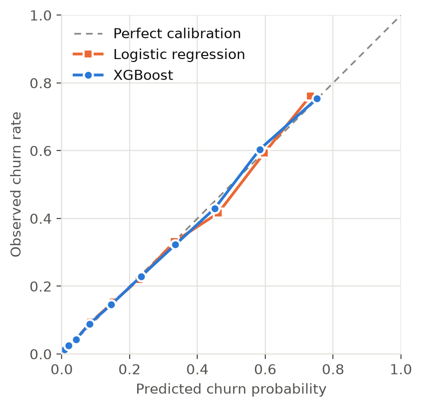

# Introduction

A telecom operator loses revenue every time a customer leaves (*churn*). Its retention team has a limited budget and must decide whom to contact and with which offer. A model that ranks customers by churn risk helps with the first decision but not with the second, because the right offer depends on the *reason* a customer is at risk: a price discount does not fix a bad experience with technical support. Without a reason, the team can neither act nor decide whether to trust the score.

There are two stakeholders. The **retention team** needs explanations that point to an action. The **auditor** (compliance, or a data-science lead) needs to check that the model relies on sensible drivers and not on artefacts of the data.

Published churn studies generally attach an explanation method to a model, most often SHAP, but rarely test the explanations. One of them states it plainly: it "did not evaluate the given explanations" because "evaluation has proven to be a challenge" [1]. The closest check we found in the ten papers we reviewed is a bootstrap of the stability of a SHAP ranking [2].

This project builds a churn model on a public data set and treats the explanations as something to be *tested and used*. We (i) train a model that is shown not to be overfitted, (ii) apply three complementary explanation techniques, global, local and evaluative, (iii) check the explanations with sanity tests instead of trusting them, (iv) use them to improve the model and to propose retention levers, and (v) state what they cannot tell us, above all that a driver of the *prediction* is not a *cause* of churn.

# Data and methods

## Task and data

The task is binary classification: from the profile of a customer (demographics, contracted services, contract and billing, tenure), predict whether they churned. We use the IBM Telco Customer Churn sample data set [3]: 7,043 customers and 21 columns, of which 26.5 % churned. The features are 4 numeric (`SeniorCitizen`, `tenure`, `MonthlyCharges`, `TotalCharges`) and 15 categorical; the target is `Churn`. Churn depends strongly on the contract: 42.7 % for month-to-month, 11.3 % for one-year and 2.8 % for two-year contracts.

Preprocessing is deliberately small. `customerID` is dropped (it identifies a row, it is not a feature). `TotalCharges` is text in the raw file because 11 rows are blank; all 11 are customers with `tenure = 0` (signed up, not billed yet), so we set it to 0 and refuse any other blank. This cleaning is row-wise and learns nothing from the data, so it cannot leak. Everything that is fitted (one-hot encoding, standardisation for the linear model) lives inside a scikit-learn `Pipeline` and is refitted on each training fold. The data contain 22 duplicated rows; we keep them, which makes the test estimate very slightly optimistic.

## Evaluation protocol

The data are cross-sectional, with no time axis, so we use a stratified random 80/20 split (seed 42); a time-aware split would need dates we do not have. Hyperparameters are chosen by 5-fold cross-validation on the training set only, and the reported CV score is *nested* (the search is repeated inside each outer fold). The test set is scored once and never used to fit or tune. "Not overfitted" is defined before tuning as a gap between train and CV ROC-AUC below 0.03.

Because only 26.5 % of customers churn, we report metrics of the **churn class** (precision, recall, F1, PR-AUC) and the Brier score, never accuracy alone. We do not resample or re-weight the classes. Imbalance is handled by the decision threshold, which is chosen to minimise an expected cost in which a missed churner costs *r* times a wasted offer. The ratio *r* = 5 is an **assumption** (the value used in [2]); we repeat the analysis for *r* = 2 and 10. The threshold is chosen on out-of-fold predictions of the training set.

## Models

We compare three models: a **majority-class** baseline; **logistic regression** (L2, tuned `C`, standardised numeric features), the interpretable reference; and **XGBoost** (tuned depth and number of trees), the main model whose explanations we study.

<!-- TODO (slices 3-5): explain XAI techniques and why each fits this model and data. -->

# Results

## Model performance

Table 1 shows that both models are in the range reported for this data set (an AUC of 0.859 for logistic regression in [4]) and that neither is overfitted: the train-CV gap is 0.004 and 0.008, well below the 0.03 we allowed, and the test AUC lies within one CV standard deviation of the CV estimate. There is no sign of leakage; an AUC above 0.90 would have been treated as one. XGBoost is ahead of logistic regression by 0.005 in CV ROC-AUC, less than the spread between folds (0.012), so the two are not separable on that metric. The best XGBoost turns out to be a set of depth-1 trees, which is an *additive* model: on this data set interactions between features are not needed to predict well.

| Model | Train AUC | CV AUC (± sd) | Test AUC | Gap | CV PR-AUC | Test PR-AUC |
|---|---|---|---|---|---|---|
| Majority class | 0.500 | 0.500 ± 0.000 | 0.500 | 0.000 | 0.265 | 0.265 |
| Logistic regression | 0.850 | 0.846 ± 0.013 | 0.841 | 0.004 | 0.661 | 0.628 |
| XGBoost | 0.859 | 0.851 ± 0.012 | 0.848 | 0.008 | 0.672 | 0.670 |

: **Table 1.** Discrimination. Gap = train AUC minus CV AUC. A model with no skill has PR-AUC equal to the churn rate (0.265).

## Decision threshold and cost

At *r* = 5 the cost-optimal threshold is 0.17 for both models, the value 1/(1+*r*) that a perfectly calibrated model would give (for *r* = 2 and 10 it stays within 0.04 of it). This is only weak evidence, because the cost curve is flat around its minimum; the direct check is the calibration curve (Figure 1), where the worst bin is off by 0.045 for logistic regression and 0.021 for XGBoost.

At that threshold (Table 2) both models find 88-90 % of the churners, and about 45 of every 100 customers contacted are real churners, against 26.5 % in the population. Their accuracy (0.68-0.69) is *lower* than that of the majority classifier (0.735), which finds no churner at all: accuracy alone would choose the wrong model. Against the better policy that needs no model ("contact everybody" at *r* = 5) the models cut the expected cost per customer by 41-42 %, and by 32-44 % across the three ratios. This is a saving in classification errors under an assumed cost, not the measured effect of a retention campaign. A paired bootstrap over the test customers shows that the cost difference between the two models is not distinguishable from zero for any ratio (95 % interval −0.038 to 0.021 at *r* = 5).

| Model | Precision | Recall | F1 | Accuracy | Brier | Cost per customer |
|---|---|---|---|---|---|---|
| Majority (never flags) | 0.000 | 0.000 | 0.000 | 0.735 | 0.195 | 1.327 |
| Logistic regression | 0.450 | 0.898 | 0.600 | 0.682 | 0.139 | 0.426 |
| XGBoost | 0.456 | 0.882 | 0.602 | 0.690 | 0.134 | 0.435 |

: **Table 2.** Test set at *r* = 5 and threshold 0.17 (churn-class metrics). Contacting everybody costs 0.735 per customer; the two models cut this by 42.0 % and 40.8 %.

{ width=55% }

<!-- TODO (slices 3-7): XAI results, actions and insights, discussion. -->

# References

1. N. Cao, "Explainable Artificial Intelligence for Customer Churning Prediction in Banking," *Proc. 2nd Int. Conf. on Human-centered Artificial Intelligence (Computing4Human 2021)*, CEUR-WS, 2021.
2. A. El Attar and M. El-Hajj, "Explainable AI-driven customer churn prediction: a multi-model ensemble approach with SHAP-based feature analysis," *Frontiers in Artificial Intelligence*, vol. 9, art. 1748799, 2026.
3. IBM, "Telco Customer Churn" sample data set, <https://raw.githubusercontent.com/IBM/telco-customer-churn-on-icp4d/master/data/Telco-Customer-Churn.csv>.
4. S.-V. Oprea and A. Bâra, "Customer-Centric Decision-Making with XAI and Counterfactual Explanations for Churn Mitigation," *J. Theor. Appl. Electron. Commer. Res.*, vol. 20, no. 2, art. 129, 2025. doi:10.3390/jtaer20020129.
