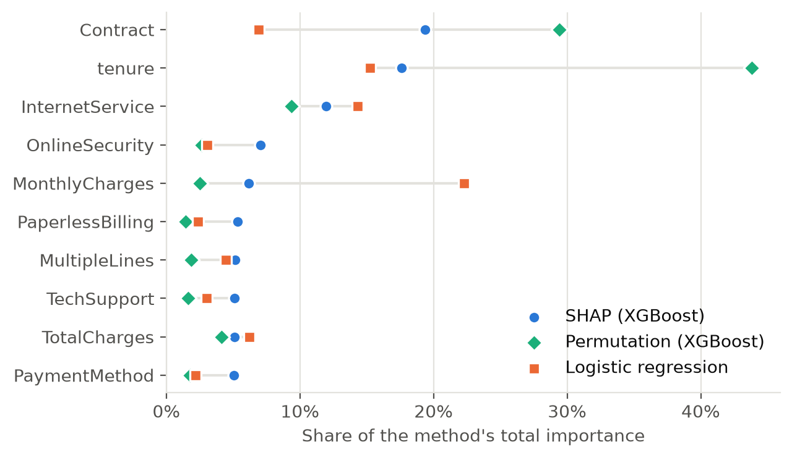
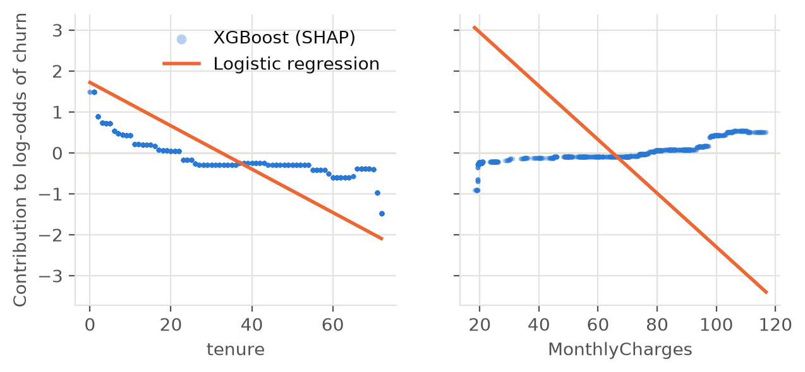
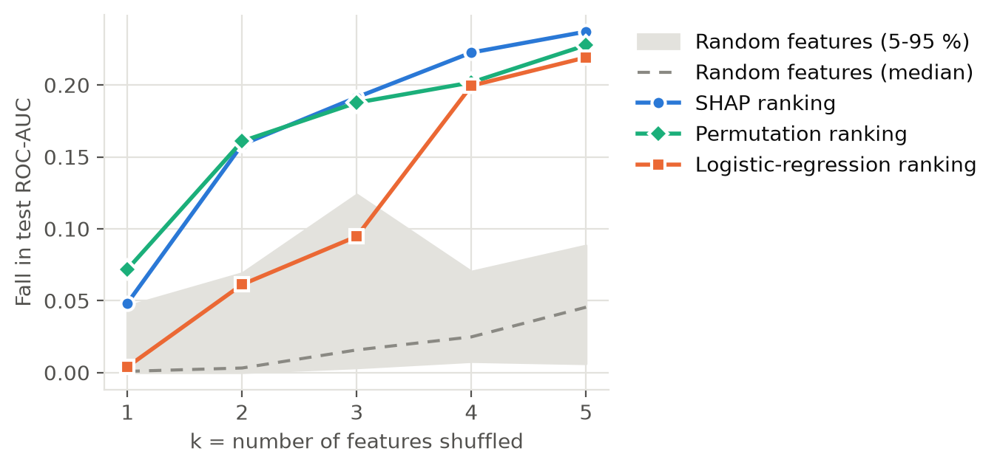
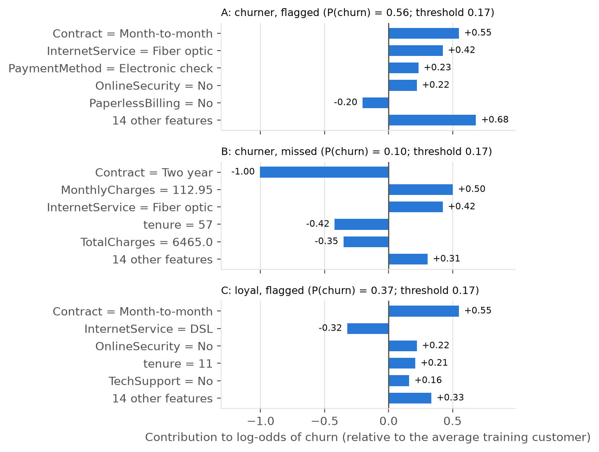

# Introduction

A telecom operator loses revenue every time a customer leaves (*churn*). Its retention team has a limited budget and must decide whom to contact and with which offer. A model that ranks customers by churn risk helps with the first decision but not with the second, because the right offer depends on the *reason* a customer is at risk: a price discount does not fix a bad experience with technical support. Without a reason, the team can neither act nor decide whether to trust the score.

There are two stakeholders. The **retention team** needs explanations that point to an action. The **auditor** (compliance, or a data-science lead) needs to check that the model relies on sensible drivers and not on artefacts of the data.

Published churn studies generally attach an explanation method to a model, most often SHAP, but rarely test the explanations. One of them states it plainly: it "did not evaluate the given explanations" because "evaluation has proven to be a challenge" [1]. The closest check we found in the ten papers we reviewed is a bootstrap of the stability of a SHAP ranking [2].

This project builds a churn model on a public data set and treats the explanations as something to be *tested and used*. We (i) train a model that is shown not to be overfitted, (ii) apply three complementary explanation techniques, global, local and evaluative, (iii) check the explanations with sanity tests instead of trusting them, (iv) use them to improve the model and to propose retention levers, and (v) state what they cannot tell us, above all that a driver of the *prediction* is not a *cause* of churn.

# Data and methods

## Task and data

The task is binary classification: from the profile of a customer (demographics, contracted services, contract and billing, tenure), predict whether they churned. We use the IBM Telco Customer Churn sample data set [3]: 7,043 customers and 21 columns, of which 26.5 % churned. The features are 4 numeric (`SeniorCitizen`, `tenure`, `MonthlyCharges`, `TotalCharges`) and 15 categorical; the target is `Churn`. Churn depends strongly on the contract: 42.7 % for month-to-month, 11.3 % for one-year and 2.8 % for two-year contracts.

Preprocessing is deliberately small. `customerID` is dropped (it identifies a row, it is not a feature). `TotalCharges` is text in the raw file because 11 rows are blank; all 11 are customers with `tenure = 0` (signed up, not billed yet), so we set it to 0 and refuse any other blank. This cleaning is row-wise and learns nothing from the data, so it cannot leak. Everything that is fitted (one-hot encoding, standardisation for the linear model) lives inside a scikit-learn `Pipeline` and is refitted on each training fold. The data contain 22 duplicated rows; we keep them, which makes the test estimate very slightly optimistic.

## Evaluation protocol

The data are cross-sectional, with no time axis, so we use a stratified random 80/20 split (seed 42); a time-aware split would need dates we do not have. Hyperparameters are chosen by 5-fold cross-validation on the training set only, and the reported CV score is *nested* (the search is repeated inside each outer fold). The test set is scored once and never used to fit or tune. "Not overfitted" is defined before tuning as a gap between train and CV ROC-AUC below 0.03.

Because only 26.5 % of customers churn, we report metrics of the **churn class** (precision, recall, F1, PR-AUC) and the Brier score, never accuracy alone. We do not resample or re-weight the classes. Imbalance is handled by the decision threshold, which is chosen to minimise an expected cost in which a missed churner costs *r* times a wasted offer. The ratio *r* = 5 is an **assumption** (the value used in [2]); we repeat the analysis for *r* = 2 and 10. The threshold is chosen on out-of-fold predictions of the training set.

## Models

We compare three models: a **majority-class** baseline; **logistic regression** (L2, tuned `C`, standardised numeric features), the interpretable reference; and **XGBoost** (tuned depth and number of trees), the main model whose explanations we study.

## Explanation techniques

We explain XGBoost with three complementary techniques and read logistic regression as an intrinsically interpretable reference. Explanations are computed on the test set and expressed in log-odds of churn (positive means towards churn). They describe the model, not the world.

*Global.* **TreeSHAP** [5, 6] splits each prediction into one additive contribution per feature (exact Shapley values, fast for tree ensembles). It fits because the main model is a tree ensemble on tabular data, and its additivity lets us add the one-hot columns of a feature back together. Global importance is the mean absolute contribution: what the model **uses**. **Permutation importance** [7] shuffles one feature and measures the fall in test ROC-AUC: what the predictions **need**, in another unit and without opening the model. **Logistic regression contributions** (coefficient times distance to the average customer) give a reference in the same units as SHAP. All contributions are relative to the average training customer (TreeSHAP's are recentred on it, which for this additive model matches interventional SHAP within 0.07 log-odds). The three methods use different units, so we compare positions (rank correlation, top features), not magnitudes.

*Evaluation.* We adapt to tabular SHAP the sanity checks of Adebayo et al. [8], designed for saliency maps of images. (1) **Label randomisation**: refit the tuned model on shuffled labels; its explanation must stop resembling the real one (rule fixed in advance: mean Spearman correlation below 0.5), with a control that refits on resampled rows keeping the labels. We randomise labels and not the model's parameters, because randomising the parameters of a tree ensemble has no natural equivalent and the assignment allows either. (2) **Shuffling the important features**: shuffling the k top-ranked features (ranking computed on the training set) must lower the test AUC by more than the 95th percentile of shuffling 30 random sets of k features, for k = 1, 2, 3. We apply it to the SHAP, permutation and logistic-regression rankings, and read the SHAP ranking backwards as a negative control.

*Local.* The same TreeSHAP values, read for one customer, add up to that customer's log-odds. We show the customer at the median probability of each group (a churner flagged, a churner missed, a loyal customer flagged) at the operating threshold, instead of extreme cases.

*Counterfactuals.* **DiCE** [9] proposes alternative changes to one customer that flip the model's decision. We restrict it to the levers an operator controls (contract, payment method, paperless billing and add-on services), shift the model's decision boundary to our threshold, and compare its proposals with the exact minimum found by trying every combination of the levers.

# Results

## Model performance

Table 1 shows that both models are in the range reported for this data set (an AUC of 0.859 for logistic regression in [4]) and that neither is overfitted: the train-CV gap is 0.004 and 0.008, well below the 0.03 we allowed, and the test AUC lies within one CV standard deviation of the CV estimate. There is no sign of leakage; an AUC above 0.90 would have been treated as one. XGBoost is ahead of logistic regression by 0.005 in CV ROC-AUC, less than the spread between folds (0.012), so the two are not separable on that metric. The best XGBoost turns out to be a set of depth-1 trees, which is an *additive* model: on this data set interactions between features are not needed to predict well.

| Model | Train AUC | CV AUC (± sd) | Test AUC | Gap | CV PR-AUC | Test PR-AUC |
|---|---|---|---|---|---|---|
| Majority class | 0.500 | 0.500 ± 0.000 | 0.500 | 0.000 | 0.265 | 0.265 |
| Logistic regression | 0.850 | 0.846 ± 0.013 | 0.841 | 0.004 | 0.661 | 0.628 |
| XGBoost | 0.859 | 0.851 ± 0.012 | 0.848 | 0.008 | 0.672 | 0.670 |

: **Table 1.** Discrimination. Gap = train AUC minus CV AUC. A model with no skill has PR-AUC equal to the churn rate (0.265).

## Decision threshold and cost

At *r* = 5 the cost-optimal threshold is 0.17 for both models, the value 1/(1+*r*) that a perfectly calibrated model would give (for *r* = 2 and 10 it stays within 0.04 of it). This is only weak evidence, because the cost curve is flat around its minimum; the direct check is the calibration curve (Figure 1), where the worst bin is off by 0.045 for logistic regression and 0.021 for XGBoost.

At that threshold (Table 2) both models find 88-90 % of the churners, and about 45 of every 100 customers contacted are real churners, against 26.5 % in the population. Their accuracy (0.68-0.69) is *lower* than that of the majority classifier (0.735), which finds no churner at all: accuracy alone would choose the wrong model. Against the better policy that needs no model ("contact everybody" at *r* = 5) the models cut the expected cost per customer by 41-42 %, and by 32-44 % across the three ratios. This is a saving in classification errors under an assumed cost, not the measured effect of a retention campaign. A paired bootstrap over the test customers shows that the cost difference between the two models is not distinguishable from zero for any ratio (95 % interval −0.038 to 0.021 at *r* = 5).

| Model | Precision | Recall | F1 | Accuracy | Brier | Cost per customer |
|---|---|---|---|---|---|---|
| Majority (never flags) | 0.000 | 0.000 | 0.000 | 0.735 | 0.195 | 1.327 |
| Logistic regression | 0.450 | 0.898 | 0.600 | 0.682 | 0.139 | 0.426 |
| XGBoost | 0.456 | 0.882 | 0.602 | 0.690 | 0.134 | 0.435 |

: **Table 2.** Test set at *r* = 5 and threshold 0.17 (churn-class metrics). Contacting everybody costs 0.735 per customer; the two models cut this by 42.0 % and 40.8 %.

{ width=48% }

## Global explanations

Figure 2 compares the three methods. SHAP and permutation importance, both on XGBoost, share their top three features (contract type, tenure and type of internet service) and correlate at 0.83 over the 19 features; the logistic regression shares two of them (0.79 with SHAP, 0.61 with permutation). Beyond the top three the rankings are mostly noise: the permutation importances of several features are indistinguishable within their standard deviation. The disagreements are the informative part.

(i) *Which feature is first depends on the method.* SHAP puts contract first by a small margin (19.4 % of its total against 17.6 % for tenure), permutation puts tenure first (43.8 % against 29.4 %), and the logistic regression puts MonthlyCharges first (22 %). SHAP measures how far the model's output moves because of a feature, permutation how much the AUC falls without it, so only positions can be compared across methods. (ii) *For MonthlyCharges, collinearity flips the sign.* The contracted services alone predict it with a cross-validated R² of 0.999, so it carries no information of its own. Its marginal correlation with churn is positive (+0.20), but the standardised logistic coefficient is −1.97: given the services the sign reverses, and the contribution runs from −3.4 to +3.1 log-odds against −0.91 to +0.54 in XGBoost. It must not be read as a pricing insight. (iii) *Correlated features duplicate credit.* Customers without internet service receive a negative contribution from each add-on feature on top of the one from InternetService itself.

{ width=72% }

Figure 3 shows the shape of the two main numeric effects. The effect of tenure is not linear: +1.48 log-odds in the first two months, +0.39 at 7 to 12 months, about 0 at 13 to 24 and −0.48 at 49 to 71 (the jump at the maximum value, 72, is a boundary effect we do not interpret). By level, month-to-month contracts add +0.55 log-odds against −1.00 for two-year contracts, fibre optic +0.42 against −0.32 for DSL, and electronic check +0.23 against −0.12 for the other payment methods. These are differences in what the model *predicts* between groups of customers, not the effect of changing a customer's contract.

{ width=72% }

## Sanity checks of the explanations

Both checks were run with rules fixed before seeing the results. *Label randomisation is passed.* A model fitted on shuffled labels has a test AUC of 0.517 and its explanation correlates 0.31 on average with the real one (range 0.04 to 0.60), against 0.92 for refits that keep the labels, and its total attribution falls to about 15 % of the real model's (0.46 against 3.12). The correlation is not zero: a model with no signal still ranks TotalCharges, MonthlyCharges, tenure and PaymentMethod highest, because continuous features offer more places to split, so a high rank for a numeric feature is not evidence by itself.

*Shuffling the top features* (Figure 4) is passed by the SHAP and permutation rankings and failed by the logistic regression's. Shuffling the top 2 and top 3 SHAP features costs 0.159 and 0.191 of AUC, against 95th percentiles of 0.069 and 0.124 for random features (permutation ranking: 0.161 and 0.188). At k = 1 SHAP passes only narrowly (0.048 against 0.046). The logistic ranking fails (0.004, 0.061, 0.095) because its first feature, MonthlyCharges, is redundant for XGBoost: it explains a different model. The SHAP ranking read backwards costs 0.000 for every k, so the check is able to say no. Two caveats: the permutation ranking is favoured by construction, since it optimises the same quantity, and shuffling one feature of a correlated pair leaves the other intact, which understates the damage.

{ width=56% }

## Local explanations

Figure 5 explains three typical customers. **A**, a churner the model flags (P = 0.56), is pushed up by a month-to-month contract (+0.55), fibre optic (+0.42), electronic check (+0.23) and no online security (+0.22): reasons the operator can act on. **B**, a churner the model misses (P = 0.10), has a two-year contract (−1.00), 57 months of tenure (−0.42) and a large accumulated bill (−0.35) that outweigh a high monthly charge and fibre optic (+0.50, +0.42). Every loyalty marker points the other way, and what made this customer leave is not in the data (an inference: complaints or competing offers are not observed). **C**, a wasted offer (P = 0.37), is flagged for a month-to-month contract and no add-ons: it looks like a churner and stayed. SHAP explains the model's score, not the customer's reason, and case B shows contributions for MonthlyCharges and TotalCharges although both are redundant, the credit-splitting problem discussed above.

{ width=56% }

# Actions and insights

## Improving the model

The explanations flagged two features as redundant: MonthlyCharges (predicted from the services with a cross-validated R² of 0.999) and TotalCharges (R² of 0.999 from tenure and MonthlyCharges). Our hypothesis was that removing them keeps performance and makes the explanations easier to read. We tested four versions of the model, tuned by the same nested cross-validation on the training set and compared fold by fold, with a rule fixed in advance: adopt the smallest version that loses no more than 0.003 of AUC and 0.005 of cost per customer. Removing both passes (paired difference of CV AUC +0.0001 ± 0.0013); removing only TotalCharges does not (cost +0.0064). Table 3 gives the test-set result, scored once per version.

| Version | Features | CV AUC | Test AUC | Train-CV gap | Test PR-AUC | Cost | Stability |
|---|---|---|---|---|---|---|---|
| Before | 19 | 0.8508 | 0.8481 | 0.0082 | 0.670 | 0.433 | 0.882 |
| After | 17 | 0.8509 | 0.8482 | 0.0053 | 0.669 | 0.437 | 0.894 |

: **Table 3.** Model improvement. Cost per customer at the threshold 1/(1+*r*) = 0.167 (Table 2 used 0.17 chosen on out-of-fold data). Stability: mean Spearman correlation between the SHAP importance rankings of 8 bootstrap refits, on the 17 shared features.

The model uses the two candidates (shuffling them costs 0.008 and 0.006 of AUC on the training set, against a median of 0.001 for the other features) but gets the same information elsewhere, so it is as good with two fewer features and overfits less. The gain is one of simplicity, not accuracy. Our hypothesis about stability is only weakly supported: 0.882 against 0.894, a rise that 8 refits cannot separate from noise. The credit does move (mean absolute SHAP, not renormalised): the 0.25 log-odds held by MonthlyCharges goes mainly to tenure (0.56 to 0.69, which also inherits what TotalCharges carried) and to InternetService (0.36 to 0.47), an inference from the numbers and not a test.

## Business insights and levers

*Prioritisation.* The threshold that minimises cost at *r* = 5 flags 51 % of the customers. With a smaller budget, contacting the top 10 % reaches 29 % of the churners (churn rate 77 %, 2.9 times the base rate), the top 20 % reaches 51 % and the top 30 % 66 %.

*Levers.* We took the 611 flagged month-to-month customers with internet service (43 % of the test set, 49 % of whom churned) and searched, for each, the fewest changes to the levers that bring the predicted risk below the threshold (Table 4). Longer commitment dominates: without changing the contract this is possible for only 26 % of them. Without a new contract the change used most is switching paperless billing *off* (118 of the 156 solutions), which nobody would expect to keep a customer: the model uses markers of loyal customers without knowing why. All six DiCE proposals for two customers included the two-year contract and had the minimum number of changes found by the exhaustive search (two and three), although DiCE does not guarantee this.

| Levers allowed | Below the threshold | One change is enough | Mean risk before → after |
|---|---|---|---|
| Add-ons and billing only | 26 % | 7 % | 0.28 → 0.15 |
| + contract up to one year | 70 % | 18 % | 0.41 → 0.14 |
| + contract up to two years | 92 % | 49 % | 0.47 → 0.12 |

: **Table 4.** Share of the 611 at-risk customers that the model places below the threshold, by levers allowed. Each row concerns different customers (the ones movable with fewer levers are lower-risk).

*What it would take to pay.* We know neither the value *V* of a retained customer nor the cost *c* of a lever, so instead of a saving we give the break-even. On the 156 customers that billing and add-ons alone can bring below the threshold, the modelled fall in risk is 0.135 (add-ons and billing), 0.156 (up to a one-year contract) and 0.207 (up to two years). If that fall were entirely causal, a lever pays when *V* > 7.4 *c*, 6.4 *c* or 4.8 *c*; if only a quarter of it is real, *V* > 30 *c*, 26 *c* or 19 *c*. The costs *c* of the three levers differ, so the rows are not comparable with each other.

# Discussion

**What the explanations are not.** They describe the model, not the world. The sanity checks show that the rankings are related to what the model needs, not that magnitudes or directions are right; the methods disagree beyond the top three features; and correlated features share or duplicate credit (MonthlyCharges, the add-on services), so a one-feature importance is a poor summary. The explanation of one model says little about another: the logistic ranking failed the check on XGBoost.

**How a stakeholder could misread them.** (i) "Month-to-month contracts cause churn, so move customers to two-year contracts": the contract is a marker of loyalty as much as a cause, and for half of the at-risk customers that change alone is enough for the model. (ii) "Turn off paperless billing": a marker with no plausible causal role that is the change used most when the contract is left alone (118 of 156 solutions). (iii) "MonthlyCharges is the top driver" (logistic regression): an artefact of collinearity, with the opposite sign to its marginal correlation. (iv) Reading the customers we can move without a new contract as retention potential.

**Predicting who leaves is not predicting whom an offer retains.** The model ranks risk; the value of an offer depends on its causal effect (uplift), which these data cannot measure. A field experiment found that proactively recommending plans raised churn, from 6 % to 10 % [10], and targeting high-risk customers can be ineffective [11]. The next step is a randomised pilot on the flagged customers.

**Data, time and assumptions.** The data are one cross-section, so a random split cannot reveal drift; in a real deployment the best model fell from an AUC of 93.3 % to 89 % on later data [12], so explanations must be recomputed and re-tested when the model is retrained. The near-perfect linear relation between price and services suggests the data set was built from a price list, which real data rarely are (our inference). The cost ratio, the threshold and the customer value are assumptions. We did not analyse fairness across customer groups although gender, age and partner are in the model, nor repeat the sanity checks on the adopted model.

# References

1. N. Cao, "Explainable Artificial Intelligence for Customer Churning Prediction in Banking," *Proc. 2nd Int. Conf. on Human-centered Artificial Intelligence (Computing4Human 2021)*, CEUR-WS, 2021.
2. A. El Attar and M. El-Hajj, "Explainable AI-driven customer churn prediction: a multi-model ensemble approach with SHAP-based feature analysis," *Frontiers in Artificial Intelligence*, vol. 9, art. 1748799, 2026.
3. IBM, "Telco Customer Churn" sample data set, <https://raw.githubusercontent.com/IBM/telco-customer-churn-on-icp4d/master/data/Telco-Customer-Churn.csv>.
4. S.-V. Oprea and A. Bâra, "Customer-Centric Decision-Making with XAI and Counterfactual Explanations for Churn Mitigation," *J. Theor. Appl. Electron. Commer. Res.*, vol. 20, no. 2, art. 129, 2025. doi:10.3390/jtaer20020129.
5. S. M. Lundberg and S.-I. Lee, "A Unified Approach to Interpreting Model Predictions," *Advances in Neural Information Processing Systems 30 (NeurIPS 2017)*, 2017.
6. S. M. Lundberg, G. Erion, H. Chen *et al.*, "From local explanations to global understanding with explainable AI for trees," *Nature Machine Intelligence*, vol. 2, pp. 56-67, 2020. doi:10.1038/s42256-019-0138-9.
7. A. Fisher, C. Rudin and F. Dominici, "All Models are Wrong, but Many are Useful: Learning a Variable's Importance by Studying an Entire Class of Prediction Models Simultaneously," *J. Mach. Learn. Res.*, vol. 20, 2019. <https://jmlr.org/papers/v20/18-760.html>
8. J. Adebayo, J. Gilmer, M. Muelly, I. Goodfellow, M. Hardt and B. Kim, "Sanity Checks for Saliency Maps," *Advances in Neural Information Processing Systems 31 (NeurIPS 2018)*, 2018. arXiv:1810.03292.
9. R. K. Mothilal, A. Sharma and C. Tan, "Explaining Machine Learning Classifiers through Diverse Counterfactual Explanations," *Proc. ACM FAT\* 2020*, 2020. arXiv:1905.07697.
10. E. Ascarza, R. Iyengar and M. Schleicher, "The Perils of Proactive Churn Prevention Using Plan Recommendations: Evidence from a Field Experiment," *J. Marketing Research*, vol. 53, no. 1, pp. 46-60, 2016.
11. E. Ascarza, "Retention Futility: Targeting High-Risk Customers Might be Ineffective," *J. Marketing Research*, 2018.
12. A. K. Ahmad, A. Jafar and K. Aljoumaa, "Customer churn prediction in telecom using machine learning in big data platform," *J. Big Data*, vol. 6, art. 28, 2019. doi:10.1186/s40537-019-0191-6.
